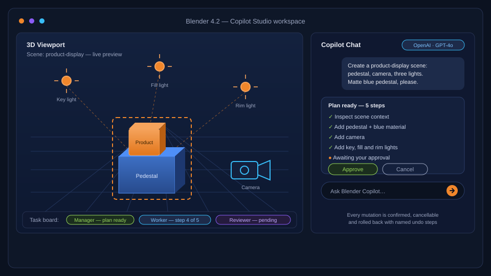
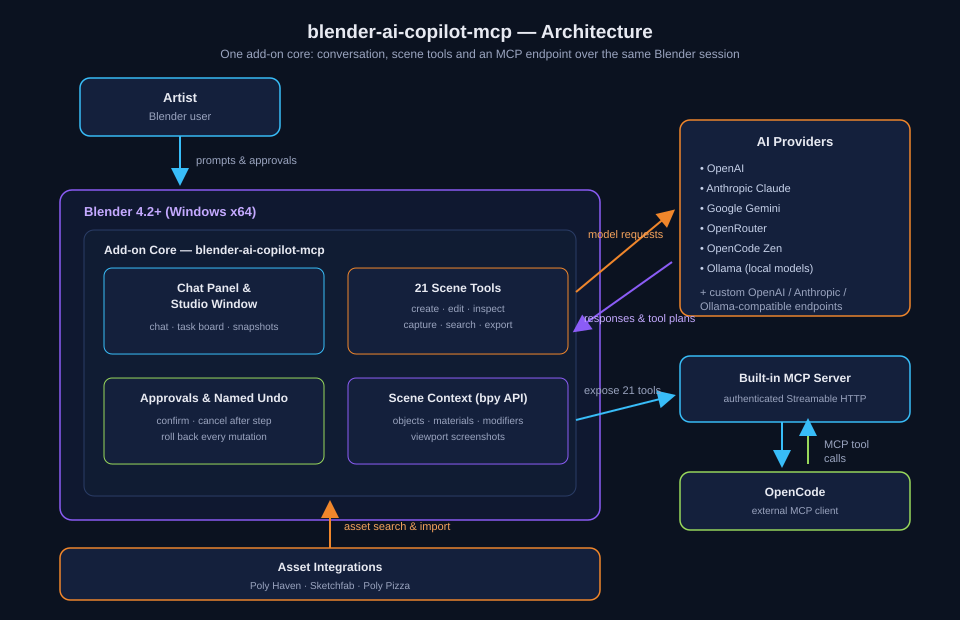

# Blender AI Copilot MCP
**An AI copilot for Blender that inspects your scene, builds objects, edits materials, finds assets and runs multi-step agent workflows — with a visual Studio workspace and a built-in Model Context Protocol (MCP) server.**

[download-url]: https://github.com/hitkeeen/blender-ai-copilot-mcp/releases/latest

     

[][download-url]

## Why
You know the result you want — a clean product display, a row of neatly spaced copies, a matte blue pedestal — but Blender makes you earn it click by click. Blender AI Copilot MCP puts an assistant inside Blender that looks at your scene first, plans the operations, executes them with your approval and shows the outcome in a live viewport preview. You stay in Blender, iterate in minutes instead of hours and keep full control: every mutation is confirmed, cancellable after the current step and rolled back with named undo steps.

## Without / With
| Without | With |
|---|---|
| Building light rigs, pedestals and camera setups by hand | One prompt assembles the scene — objects, materials and lighting included |
| Copy-pasting objects and eyeballing the spacing | The assistant duplicates and arranges objects into ordered layouts for you |
| Hunting assets in a browser, importing, scaling, re-importing | Search across Poly Haven, Sketchfab and Poly Pizza — with a confirmation before import |
| AI that guesses what your scene contains | Scene and object inspection give the copilot context before it acts |
| Chat in one window, viewport in another, nothing shared | A Studio workspace beside the viewport: chat, task board, approvals and snapshots together |
| Automation tied to a single vendor | Your choice of AI: OpenAI, Anthropic Claude, Google Gemini, OpenRouter, OpenCode Zen, local Ollama or custom endpoints |

## Quick Start
1. [Download][download-url] the `blender-ai-copilot-mcp.zip` bundle and save it to your Downloads folder.
2. Unblock the downloaded ZIP — Windows marks files received from the Internet (or use Properties → Unblock in Explorer).
   `powershell Unblock-File "$env:USERPROFILE\Downloads\blender-ai-copilot-mcp.zip"`
3. In Blender open **Edit → Preferences → Get Extensions**, choose **Install from Disk** from the dropdown menu, select the ZIP and enable **Blender AI Copilot MCP**.
4. Press **N** in the 3D Viewport, open the **Copilot MCP** panel, choose a provider, add your connection details and select a model.
5. Send your first message in the panel — or click **Open Studio Window** for the full workspace.

## Features
- Inspect scenes and objects before acting, so every operation starts from real context.
- Build and edit through conversation with 21 scene tools — creation, editing, parenting, materials, cameras, lights and export.
- Connect the AI that fits your work: cloud providers, local Ollama models or OpenAI/Anthropic-compatible custom endpoints, with saved connections for work and personal keys.
- Coordinate an agent team — manager, workers and reviewers — that splits a brief into assignments and checks its own results on the task board.
- Expose Blender to external clients through the built-in authenticated MCP server (Streamable HTTP), with a preconfigured OpenCode connection.
- Find and import assets from Poly Haven, Sketchfab and Poly Pizza without leaving Blender.
- Stay in control with operation approvals, cancellation after the current step and named undo steps for every mutation.

## How it works

The add-on core bridges the Blender Python API and the Studio window: your provider connection answers chat and produces tool plans, while the same 21 scene tools are exposed through the built-in authenticated MCP server to external clients such as OpenCode — one Blender session, two ways to drive it.

## Usage
- **Product display from a prompt.** Send: *"Create a simple product-display scene with a pedestal, a camera and three lights. Give the pedestal a matte blue material."* — the copilot inspects the scene, builds the layout and shows a viewport snapshot in Studio.
- **Ordered batch edits.** Send: *"Duplicate the selected object into a neatly spaced row of five and show the viewport."* — the operations run sequentially, so your scene edits stay ordered and reviewable.
- **Automation over MCP.** Start the built-in MCP server, connect OpenCode to the authenticated local endpoint and ask: *"List the scene objects, then export the scene as glTF."* — the external client drives the same 21 scene tools.

## Configuration
| Setting | What it controls |
|---|---|
| Provider | OpenAI, Anthropic Claude, Google Gemini, OpenRouter, OpenCode Zen, local Ollama or a custom endpoint (OpenAI Chat Completions, Anthropic Messages or Ollama protocol) |
| Saved connections | Keep work and personal connections separate; store multiple keys for the same provider |
| Model | Chosen from the loaded model catalog; pick models with tool-calling support — image-capable models also interpret viewport screenshots |
| Team chain | Roles, instructions and models for manager, workers and reviewers; tasks run sequentially, a blocked task gets one correction attempt |
| Approvals and undo | Confirm mutations before execution, cancel after the current step, roll back via named undo steps |
| MCP endpoint | Built-in local server over authenticated Streamable HTTP for OpenCode and other compatible clients |
| Interface language | English, German, French, Spanish or Chinese for the main interface |

## Troubleshooting / FAQ
- **The add-on does not appear after installation.** The bundle targets Blender 4.2 or later on Windows x64 — check your Blender version and that the extension is enabled in Preferences.
- **The model ignores scene tools.** Choose a model with tool-calling support; the catalog marks the supported ones.
- **Viewport screenshots are not interpreted.** Image understanding requires an image-capable model.
- **An external MCP client cannot connect.** Keep Blender open, verify the client points to the authenticated local Streamable HTTP endpoint and re-check the port and token in the panel.
- **Windows blocked the ZIP.** Right-click the file → Properties → Unblock, or run the Unblock-File command from Quick Start.
- **Is Python execution safe?** Python tool validation catches disallowed operations; it is not a security sandbox. Approvals, named undo steps and client-side approval policies keep you in charge.

## Contributing
Issues and pull requests are welcome — fork the repository, create a feature branch and describe the change in your PR. Clear reproduction steps and a small scene file make reviews much faster.
If Blender AI Copilot MCP saves you time, give the repository a star — it helps other artists find the project.

## Keywords
blender-ai-copilot · blender ai · ai for blender · blender ai assistant · blender mcp · blender mcp server · mcp for blender · model context protocol · mcp integration · blender addon · blender extension · blender plugin · blender copilot · ai blender addon · blender chatgpt · blender claude · blender openai · blender gemini · blender ollama · blender llm · blender agents · blender multi-agent · blender automation · blender scripting · blender python · bpy api · blender api · geometry nodes · 3d modeling · 3d automation · 3d workflow · scene generation · ai modeling · ai materials · ai textures · viewport screenshot · opencode blender · ai tools for blender · blender workflow · chat in blender · ai chat blender · blender studio · blender scene tools · scene inspection · blender task board · agent team blender · ai asset search · poly haven blender · sketchfab blender · poly pizza blender · blender material editing · blender asset import · ai workspace blender · 3d assistant blender · blender productivity · ai scene builder

## License
Released under the [MIT](./LICENSE) license.
